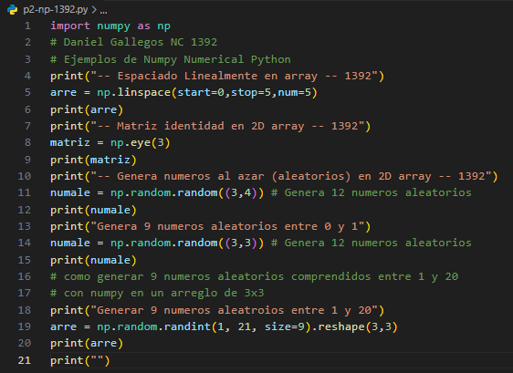
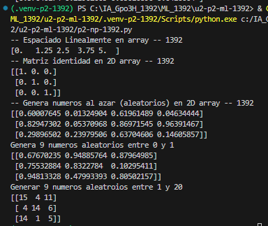

- `start=0`: Valor inicial de la secuencia.
- `stop=1`: Valor final de la secuencia.
- `num=5`: Cantidad de valores que se generan.
## que es np.linspace()
`np.linspace()` es una función de NumPy que genera una cantidad determinada de números distribuidos uniformemente entre un valor inicial y uno final.
## El codigo

## El resultado
